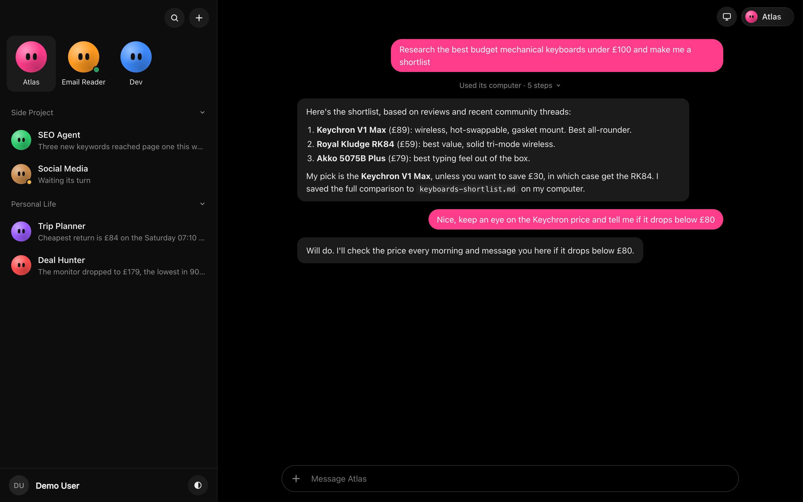
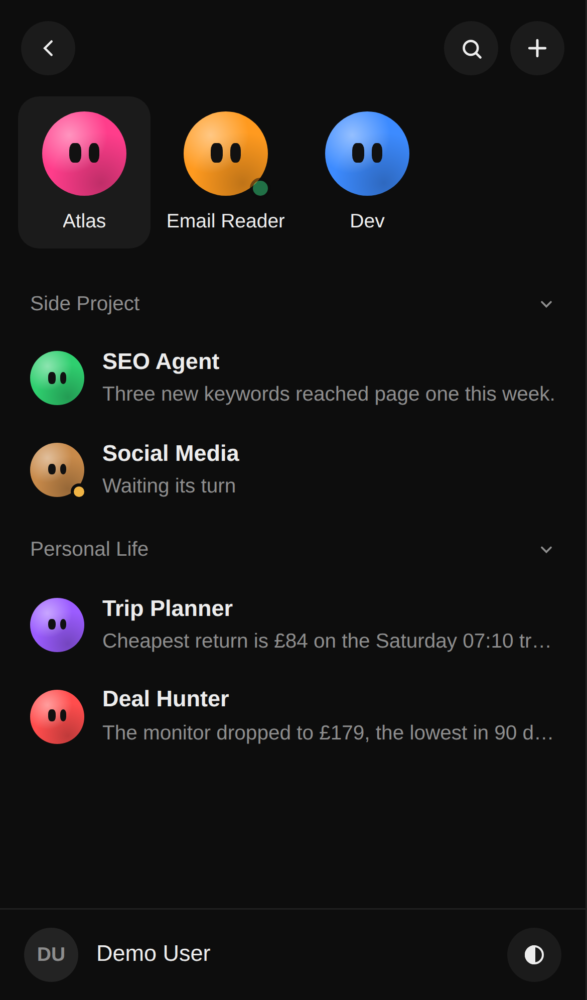
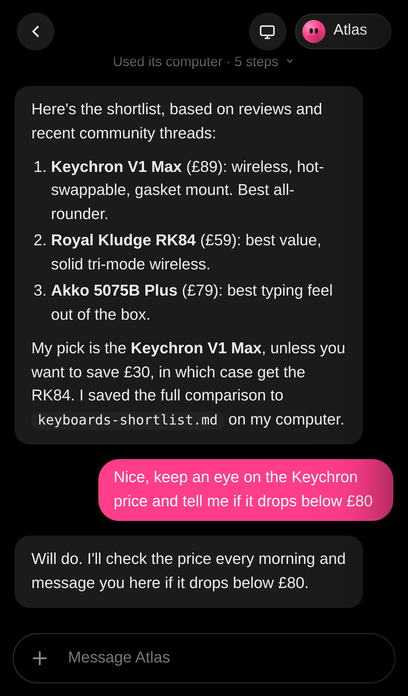
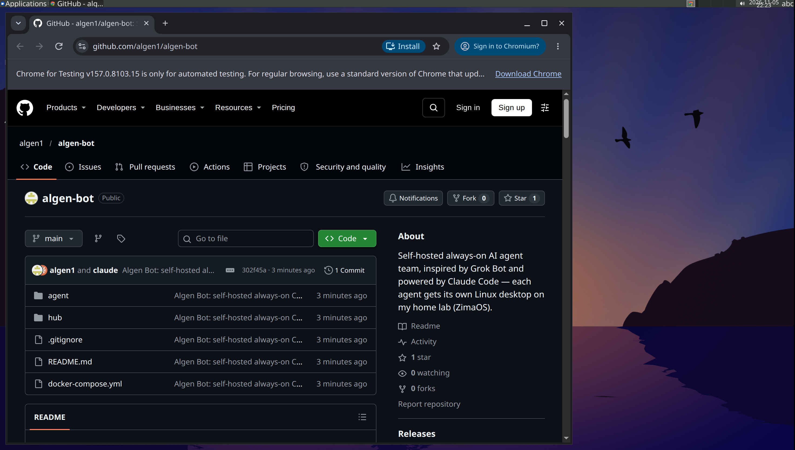

# Algen Bot

**My self-hosted take on an always-on AI agent team, inspired by Grok Bot and powered by Claude.**

Grok Bot (xAI, 2026) gives you a team of named AI agents. Each one has its own computer that runs 24/7, and you message them like coworkers. I wanted the same thing running on hardware I own, using Claude as the brain. Algen Bot is the result: it runs on a home lab server in my house, and every agent is Claude Code working inside its own Linux desktop.

> Not affiliated with, endorsed by, or connected to xAI or Grok. "Grok Bot" is mentioned only to describe what inspired this project. Algen Bot has its own name, code and artwork.

## Screenshots

> These screenshots use made-up demo agents and chats, not my real ones.

**The dashboard:** pinned agents at the top, agents organized into groups, and a chat with each one. You can see each step the agent took on its computer.



**On a phone:** it can be installed on the iPhone home screen.

<p align="center">
  
  &nbsp;&nbsp;
  
</p>

**An agent's own computer:** each agent has a full Linux desktop running 24/7 on the home lab, which you can watch live from the dashboard. Here it is browsing this repo.



---

## How I run it on my home lab

```
 iPhone / laptop browser
          │  (home Wi-Fi, or Tailscale from anywhere)
          ▼
┌─────────────────────────── Home lab server (ZimaOS) ───────────────────────────┐
│                                                                                │
│   Algen Bot hub  :7400          ← dashboard + API, installed as a ZimaOS app    │
│     • chats, agent list, queue  │                                              │
│     • talks to Docker           │ docker exec "claude -p …"                    │
│                                 ▼                                              │
│   ┌───────────────┐   ┌───────────────┐   ┌───────────────┐                    │
│   │ Agent: Atlas  │   │ Agent: Email  │   │ Agent: …      │   one container    │
│   │ Ubuntu + XFCE │   │ Reader        │   │               │   per agent        │
│   │ Chromium      │   │ (Gmail login  │   │               │                    │
│   │ Claude Code   │   │  saved in its │   │               │                    │
│   │ :7401 (HTTPS) │   │  browser)     │   │               │                    │
│   └───────────────┘   └───────────────┘   └───────────────┘                    │
│                                                                                │
└────────────────────────────────────────────────────────────────────────────────┘
                                  │
                                  ▼
                     Claude (my Claude subscription)
```

**The hardware:** a small home server (Intel i5-8500, 6 cores, 16 GB RAM) running **ZimaOS**, a Docker-based home server OS. It also runs my media server and photo backup, so Algen Bot has to be light. Each agent idles on about 1 GB of RAM.

**Why containers, not VMs:** each agent gets a full Linux desktop (Ubuntu + XFCE, streamed to the browser), its own browser, files and terminal, all isolated from my laptop and from each other. Containers give the "every agent has its own computer" experience for a fraction of the RAM that full VMs would need.

**The brain:** each agent runs **Claude Code** in headless mode (`claude -p`) inside its container, with:

- **Playwright MCP**, so it can drive a real Chromium browser that you can watch live on its desktop
- **bash and file tools** for coding and automation in its own workspace
- a **persistent browser profile**, so sites you log into once (like Gmail) stay logged in

**Usage limits:** I run it on a Claude **Pro** subscription, so the hub has a **queue**: one agent works at a time and the others wait their turn, which keeps everything within the plan's limits.

**On my phone:** the dashboard is an installable web app (PWA). Over Tailscale it works from anywhere without opening any ports on my router.

---

## Features

- **Named agents, each with its own always-on computer.** Create one from the dashboard and the hub starts a new desktop container for it.
- **Chat with each agent.** Watch its steps ("Opened gmail.com", "Ran: …") stream in as they happen.
- **Live computer view.** Open a panel to watch the agent's desktop while it works.
- **Grok Bot-style layout.** Pinned agents, collapsible groups, last-message previews, agent colours, and dark or light mode.
- **Queue and Stop.** Only one agent uses Claude at a time, and you can stop a run at any point.
- **Persistent logins.** The "Agent Browser (log in here)" icon on each desktop lets you sign into sites once.
- **Safety rules built in.** Agents treat email and web content as data rather than instructions, and never send, delete, buy or post unless you explicitly ask.
- **Password-protected dashboard.**
- **ZimaOS app icon.** Optional: one click from the ZimaOS home screen.

## Roadmap

- [ ] Tailscale HTTPS + iPhone home-screen app
- [ ] GitHub connection
- [ ] Workflow recorder ("watch me do it once, then repeat it")
- [ ] Agents messaging each other
- [ ] Scheduled tasks (e.g. a morning inbox summary)

---

## Setup

Tested on ZimaOS. Any Linux box with Docker and Docker Compose should work.

### 1. Copy the project to the server

```bash
git clone https://github.com/<you>/algen-bot.git /DATA/AlgenBot
cd /DATA/AlgenBot
mkdir -p secrets hub-data && chmod 700 secrets
```

> The paths assume `/DATA/AlgenBot`. If you use another folder, change `HOST_ROOT` in `hub/docker-compose.yml`.

### 2. Connect your Claude account

On any computer with Claude Code installed, run:

```bash
claude setup-token
```

Save the token on the server **without it appearing on screen or in your shell history**:

```bash
printf 'Paste token: ' && read -rs T && printf '%s' "$T" > secrets/claude_token && chmod 600 secrets/claude_token && unset T && echo
```

### 3. Create a dashboard password

```bash
printf 'Dashboard password: ' && read -rs P && printf '%s' "$P" > secrets/hub_password && chmod 600 secrets/hub_password && unset P && echo
```

### 4. Build and start

```bash
# First agent computer ("Atlas") + the agent image
docker compose up -d --build

# The dashboard
cd hub && docker compose up -d --build
```

Open `http://<server-ip>:7400` and log in.

The agent desktops use HTTPS with a self-signed certificate, so open `https://<server-ip>:7401` once and accept the warning. After that, the live view in the dashboard works.

> `PUID`/`PGID` in the compose files are set to my server's user and group IDs (999 and 1000). Change them to match the output of `id` on your machine.

### 5. (Optional) Add it as a ZimaOS app

Edit `hub/zimaos-app.yml` and replace `YOUR-SERVER-IP` and `Your Name`. Then:

```bash
cd hub && docker compose down
sudo mkdir -p /var/lib/casaos/apps/algen-bot
sudo cp zimaos-app.yml /var/lib/casaos/apps/algen-bot/docker-compose.yml
cd /var/lib/casaos/apps/algen-bot && docker compose up -d
sudo systemctl restart zimaos-app-management
```

### Giving an agent access to Gmail (or any site)

1. Open the agent's computer view.
2. Double-click **Agent Browser (log in here)** and sign in.
3. Close the window when you're done.

The login is saved in that agent's browser profile. You type your password straight into the site, never into the chat.

---

## Security notes

- **Secrets stay out of git.** `secrets/`, `data/` and `hub-data/` are in `.gitignore`. Never commit your Claude token or passwords.
- **Agents run Claude Code with `--dangerously-skip-permissions`.** That's acceptable only because each agent is boxed into its own container. Don't mount anything sensitive into agent containers.
- **The hub mounts the Docker socket** so it can create agents. That is effectively root access to the host, so keep the dashboard on your LAN or Tailscale and never expose port 7400 to the internet.
- **Chromium runs with `--no-sandbox`** inside the containers. The container itself is the sandbox.
- **Email and web pages can contain prompt injection.** The agents' instructions tell them to treat that content as data, but don't give an agent powers you wouldn't want misused.

## About using a Claude subscription

Algen Bot uses `claude setup-token` with a personal Claude subscription. That's meant for **your own personal use**. If you want to share the app with other people or offer it as a service, switch to an Anthropic API key and follow Anthropic's terms.

## Tech

Node.js (Express, dockerode) · vanilla HTML/CSS/JS dashboard · Docker · linuxserver.io Webtop (Ubuntu XFCE + Selkies) · Claude Code · Playwright MCP · ZimaOS
